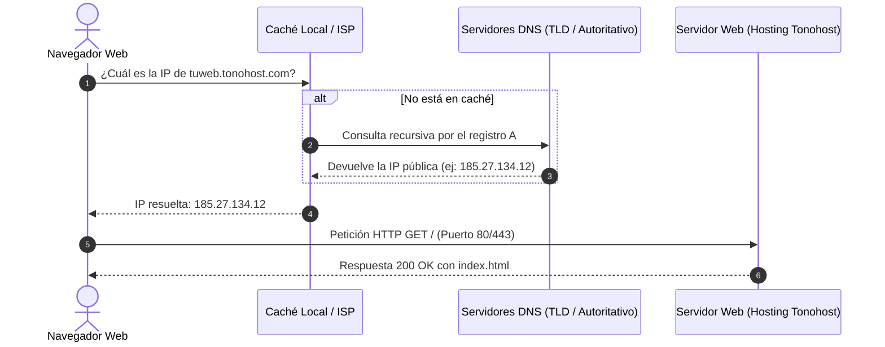

# Semana 20 - Día 5: Redes, Panel de Control (cPanel/Tonohost) y Acceso FTP con FileZilla

Guía técnica completa, conceptos de redes y paso a paso para el registro en hosting gratuito, administración de panel de control, configuración del cliente **FileZilla** y despliegue de una web estática en la carpeta pública `htdocs`.

---

## 📚 Índice de Contenidos

1. [Conocimientos Generales sobre Redes](#1-conocimientos-generales-sobre-redes)
   - Arquitectura Cliente / Servidor
   - Direcciones IP y Puertos estándar
   - El Sistema de Nombres de Dominio (DNS)
2. [¿Qué es un Panel de Control de Hosting?](#2-qué-es-un-panel-de-control-de-hosting)
   - cPanel y VistaPanel (Tonohost)
   - Módulos esenciales de administración
3. [El Protocolo FTP y el Cliente FileZilla](#3-el-protocolo-ftp-y-el-cliente-filezilla)
   - ¿Qué es FTP, FTPS y SFTP?
   - Modo Pasivo vs Modo Activo
   - Partes de la interfaz de FileZilla
   - La carpeta raíz `htdocs` y el archivo `index.html`
4. [Recursos y Materiales de la Lección](#4-recursos-y-materiales-de-la-lección)
5. [Instrucciones Paso a Paso: LAB 1 (Tonohost + FileZilla)](#5-instrucciones-paso-a-paso-lab-1-tonohost--filezilla)
6. [Instrucciones y Conclusiones: LAB 2 (Videos y Debate en Clase)](#6-instrucciones-y-conclusiones-lab-2-videos-y-debate-en-clase)
7. [Guía de Solución de Problemas Habituales (Troubleshooting)](#7-guía-de-solución-de-problemas-habituales-troubleshooting)

---

## 1. Conocimientos Generales sobre Redes

### A) El Modelo Cliente / Servidor
Toda la Web funciona bajo el modelo **Cliente/Servidor**:
- **Cliente**: Dispositivo o software (como tu navegador Chrome o el programa FileZilla) que emite una petición (*Request*).
- **Servidor**: Máquina remota con conexión permanente a Internet encargada de procesar la petición y devolver una respuesta (*Response*, como una página HTML, una imagen o un archivo).

### B) Direcciones IP y Puertos
- **Dirección IP**: El identificador numérico único de cualquier dispositivo en la red (ejemplo: `185.27.134.12` en IPv4).
  - *IP Privada*: Válida únicamente dentro de tu red local/hogar (ejemplo: `192.168.1.45`).
  - *IP Pública*: La dirección visible en Internet asignada a tu router o al servidor de hosting.
- **Puertos de Red**: Canales lógicos numerados que permiten a un mismo servidor ejecutar múltiples servicios a la vez sin interferir entre sí:

| Puerto | Protocolo | Servicio | Descripción |
| :---: | :---: | :---: | :--- |
| **21** | **FTP** | File Transfer Protocol | Canal de control para transferencia de archivos. |
| **22** | **SFTP / SSH** | Secure Shell / SFTP | Acceso remoto seguro por terminal y transferencia cifrada. |
| **53** | **DNS** | Domain Name System | Resolución de nombres de dominio a direcciones IP. |
| **80** | **HTTP** | HyperText Transfer Protocol | Peticiones y navegación web estándar (sin cifrar). |
| **443** | **HTTPS** | HTTP Seguro (TLS/SSL) | Navegación web cifrada con certificado digital. |

### C) El Sistema de Nombres de Dominio (DNS)
El **DNS** es la infraestructura distribuida que traduce nombres legibles para humanos (como `tonohost.com` o `tuweb.tonohost.com`) en las direcciones IP numéricas que necesitan las máquinas.



---

## 2. ¿Qué es un Panel de Control de Hosting?

Un **Panel de Control** es una aplicación web que provee una interfaz gráfica amigable para administrar todos los recursos de un servidor de hosting compartido o dedicado sin tener que escribir comandos de consola Linux.

### Características de cPanel / VistaPanel (Tonohost):
- **Administrador de Archivos (File Manager)**: Explorador visual similar al explorador de Windows para subir, renombrar o editar archivos en la nube.
- **Gestión de Dominios y Subdominios**: Permite crear alias o nombres del tipo `misitio.tonohost.com`.
- **Cuentas FTP**: Permite crear o consultar credenciales (host, usuario y contraseña) para conectar programas externos de transferencia.
- **Bases de Datos MySQL y phpMyAdmin**: Creación de bases de datos relacionales y gestión de tablas vía interfaz web.
- **Certificados SSL**: Configuración de cifrado HTTPS para que el navegador muestre el candado de conexión segura.

---

## 3. El Protocolo FTP y el Cliente FileZilla

### A) ¿Qué es FTP?
**FTP (File Transfer Protocol)** es un protocolo de red cliente-servidor diseñado específicamente para transferir archivos entre dos máquinas a través de una red TCP/IP.
- **FTP Tradicional**: Opera en el puerto 21. Transmite credenciales y datos en texto plano.
- **FTPS (FTP over SSL/TLS)**: Cifra la sesión mediante certificados TLS, garantizando privacidad en el canal.
- **SFTP (SSH File Transfer Protocol)**: Opera habitualmente en el puerto 22 a través del túnel seguro de SSH.

### B) Modo Pasivo (PASV) vs Modo Activo (PORT)
- En el **Modo Activo**, el servidor intenta abrir una conexión de vuelta hacia el cliente para transferir los datos. Los cortafuegos y routers caseros modernos suelen bloquear estas conexiones entrantes por seguridad.
- En el **Modo Pasivo (PASV)**, es el cliente (FileZilla) quien inicia siempre ambas conexiones (la de control y la de datos). **Por este motivo, FileZilla utiliza Modo Pasivo por defecto**.

### C) Anatomía de la Interfaz de FileZilla

```
+---------------------------------------------------------------------------------------+
|  1. BARRA DE CONEXIÓN RÁPIDA: Servidor | Nombre de usuario | Contraseña | Puerto (21)  |
+---------------------------------------------------------------------------------------+
|  2. REGISTRO DE MENSAJES: Comandos enviados y respuestas del servidor (Código 220, 230)|
+-------------------------------------------+-------------------------------------------+
|  3. SITIO LOCAL (Tu ordenador)             |  4. SITIO REMOTO (Servidor de hosting)    |
|     - Árbol de carpetas locales           |     - Árbol de carpetas remotas           |
|     - Lista de archivos (index.html, etc) |     - Carpeta /htdocs (Raíz de la web)    |
+-------------------------------------------+-------------------------------------------+
|  5. COLA DE TRANSFERENCIAS: Archivos en cola | Transferencias fallidas | Transferencias ok|
+---------------------------------------------------------------------------------------+
```

### D) La Carpeta Raíz `htdocs` y la Convención de `index.html`
> [!IMPORTANT]
> El servidor web Apache está configurado para servir a los visitantes únicamente el contenido dentro del directorio **`htdocs`** (o `public_html`).
> Si subes un archivo fuera de `htdocs`, nadie en Internet podrá verlo.
>
> Asimismo, el servidor busca automáticamente un archivo con el nombre exacto **`index.html`** (en minúsculas). Si tu archivo se llama `inicio.html` o `Index.HTML`, el servidor devolverá un error **403 Forbidden** o un listado vacío de archivos.

---

## 4. Recursos y Materiales de la Lección

- 📑 **Presentación oficial en Google Slides**:  
  [Ver Presentación de la Clase](https://docs.google.com/presentation/d/1SirTy0OweTE2tSG0QKjAb7ZALjvWnDKS/edit?usp=drive_link&ouid=110892750782689430380&rtpof=true&sd=true)
- 🎥 **Video: ¿Qué son los DNS?**:  
  [Ver en YouTube](https://www.youtube.com/watch?v=7XjJqUM0dvg)
- 🎥 **Video: Guía rápida cPanel**:  
  [Ver en YouTube](https://www.youtube.com/watch?v=e0BRJINnf6c)
- 🌐 **Plataforma de Hosting Gratuito**:  
  [https://www.tonohost.com/](https://www.tonohost.com/)
- 📥 **Descarga de Cliente FileZilla**:  
  [https://filezilla-project.org/download.php?type=client](https://filezilla-project.org/download.php?type=client)
- 📄 **Documento de Respuestas y Conclusiones del Lab**:  
  [lab_ftp_conclusiones.md](./lab_ftp_conclusiones.md)
- 💻 **Proyecto Web de Demostración Listo para Subir**:  
  Carpeta [`web_demo/`](./web_demo/):
  - [`index.html`](./web_demo/index.html)
  - [`estilos.css`](./web_demo/estilos.css)
  - [`script.js`](./web_demo/script.js)

---

## 5. Instrucciones Paso a Paso: LAB 1 (Tonohost + FileZilla)

### Paso 1: Alta en Tonohost a 0 Euros
1. Entra en [https://www.tonohost.com/](https://www.tonohost.com/) y haz clic en el plan gratuito (**Free Hosting / Ordenar ahora a 0,00 €**).
2. Elige un subdominio gratuito (ejemplo: `miweb-ironhack` `.tonohost.com` o una de las extensiones ofrecidas).
3. Introduce tu correo electrónico y define una contraseña segura.
4. Completa la verificación (revisa la bandeja de entrada o spam para pulsar el enlace de confirmación si te lo solicita).
5. Una vez activada la cuenta, accederás al panel de cliente o directamente al **cPanel (VistaPanel)**.

### Paso 2: Obtener las Credenciales FTP en el Panel
En la pantalla principal del panel o en la sección **Detalles de la Cuenta / Account Details** / **Cuentas FTP**, anota los siguientes 4 datos:
- **Servidor FTP (Host)**: Suele ser del estilo `ftpupload.net` o `ftp.tudominio.tonohost.com`.
- **Usuario FTP (Username)**: Es un código asignado por el hosting (por ejemplo `epiz_34567890` o tu nombre de usuario).
- **Contraseña FTP (Password)**: La contraseña que definiste al registrarte en el hosting (o la asignada en el panel).
- **Puerto**: `21`.

### Paso 3: Conectar FileZilla al Servidor
1. Abre **FileZilla Client**.
2. En la barra superior de **Conexión Rápida**:
   - **Servidor**: Pega el host FTP (ej: `ftpupload.net`).
   - **Nombre de usuario**: Pega tu usuario FTP.
   - **Contraseña**: Escribe tu contraseña.
   - **Puerto**: Escribe `21`.
3. Haz clic en el botón **Conexión rápida**.
4. Si aparece una ventana sobre el **Certificado TLS del servidor**, marca la casilla *"Confiar siempre en este certificado"* y pulsa **Aceptar**.
5. Observa el registro de mensajes superior: cuando aparezca `Respuesta: 230 OK` y `Estado: Directorio listado correctamente`, ¡estarás conectado!

### Paso 4: Subir los Archivos a `htdocs`
1. En el panel derecho (**Sitio Remoto**), haz doble clic sobre la carpeta **`htdocs`**.
2. Si dentro de `htdocs` existe algún archivo por defecto de bienvenida (como `index2.html` o un cartel de propaganda del hosting), puedes borrarlo o sustituirlo.
3. En el panel izquierdo (**Sitio Local**), navega hasta la carpeta del proyecto en tu ordenador:  
   `.../Sem_20/Day5/web_demo/`
4. Selecciona los tres archivos:
   - `index.html`
   - `estilos.css`
   - `script.js`
5. Haz clic derecho y selecciona **Subir** (o arrástralos directamente del panel izquierdo al panel derecho).
6. Verifica en la pestaña inferior **Transferencias satisfactorias** que los 3 archivos se han subido con éxito (0 fallidas).

### Paso 5: Comprobar el Resultado en el Navegador
1. Abre tu navegador (Chrome, Firefox o Edge).
2. Escribe la dirección web de tu subdominio (por ejemplo: `http://miweb-ironhack.tonohost.com/`).
3. Comprueba que carga la landing page moderna, que los estilos CSS se aplican correctamente y que al pulsar el botón interactivo se ejecuta el script JavaScript.
4. **Copia tu enlace público** para entregarlo o compartirlo en el laboratorio.

---

## 6. Instrucciones y Conclusiones: LAB 2 (Videos y Debate en Clase)

Consulta el archivo completo con las respuestas redactadas en:  
👉 [**lab_ftp_conclusiones.md**](./lab_ftp_conclusiones.md)

### Resumen de Puntos Clave para la Clase:
- **Sobre el video de DNS**:
  - El DNS es la infraestructura que desacopla la ubicación física/IP de los servidores de su nombre accesible.
  - La presencia de registros **A** (IPv4), **AAAA** (IPv6), **CNAME** (alias) y **MX** (correo) permite que distintos servicios residan en diferentes servidores bajo un mismo dominio.
  - La **propagación DNS** y el valor **TTL** determinan cuánto tarda un cambio de servidor en ser visible globalmente.
- **Sobre el video de cPanel**:
  - cPanel democratiza la administración de servidores Linux LAMP para cualquier desarrollador.
  - El administrador de archivos y phpMyAdmin son las dos herramientas más utilizadas en despliegues tradicionales.
- **Pregunta para debatir en clase**:
  > *Si el protocolo FTP tradicional envía contraseñas en texto claro a través de Internet por el puerto 21, ¿por qué se sigue enseñando y utilizando en hostings gratuitos, y qué medidas de seguridad debemos aplicar en entornos de producción profesional (SFTP/SSH Keys, FTPS obligatorio y restricción por IP)?*

---

## 7. Guía de Solución de Problemas Habituales (Troubleshooting)

### 🔴 Error 1: "530 Login authentication failed" o "Login incorrect"
- **Causa**: El nombre de usuario o la contraseña introducidos en FileZilla no coinciden con los del panel.
- **Solución**: En Tonohost, el usuario suele ser un identificador autogenerado (ej: `epiz_XXXXXX`), no tu correo electrónico. Comprueba en el panel de Tonohost la sección "Account Details" o "FTP Accounts" para ver el usuario exacto.

### 🔴 Error 2: "Connection timed out" / La conexión se congela al listar directorios
- **Causa**: Tu router o firewall bloquea los puertos aleatorios que intenta abrir el servidor.
- **Solución**: En FileZilla, ve a `Edición` > `Opciones` > `Conexión` > `FTP`. Asegúrate de que el modo de transferencia esté marcado como **Modo Pasivo (Recomendado)**.

### 🔴 Error 3: En el navegador sale "403 Forbidden"
- **Causa 1**: Los archivos no se han subido dentro de la carpeta `htdocs`, sino en la carpeta raíz `/`.
- **Causa 2**: El archivo principal no se llama exactamente `index.html` (comprueba que esté todo en minúsculas y no `Index.html` ni `index.htm`).

### 🔴 Error 4: He modificado el archivo pero el navegador no muestra los cambios
- **Causa**: El navegador guarda en su caché local el archivo `estilos.css` o `index.html` anterior.
- **Solución**: Haz una recarga forzada en el navegador pulsando `Ctrl + F5` (Windows) o `Cmd + Shift + R` (Mac), o prueba a abrir la web en una ventana de incógnito.

### 🔴 Error 5: Ventana de advertencia "Certificado desconocido" en FileZilla
- **Causa**: Tonohost utiliza un certificado TLS compartido o autofirmado para cifrar la conexión FTP (FTPS).
- **Solución**: Es normal en hostings gratuitos. Marca la casilla *"Confiar siempre en este certificado en futuras sesiones"* y pulsa en **Aceptar**.
